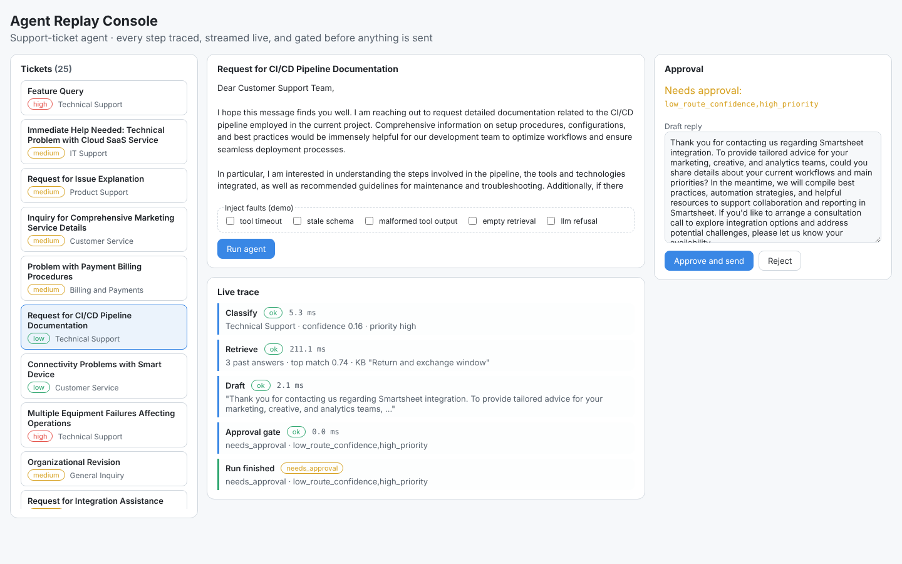
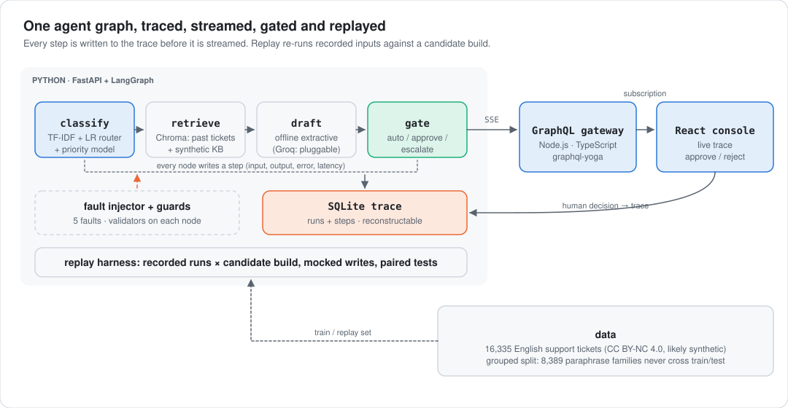
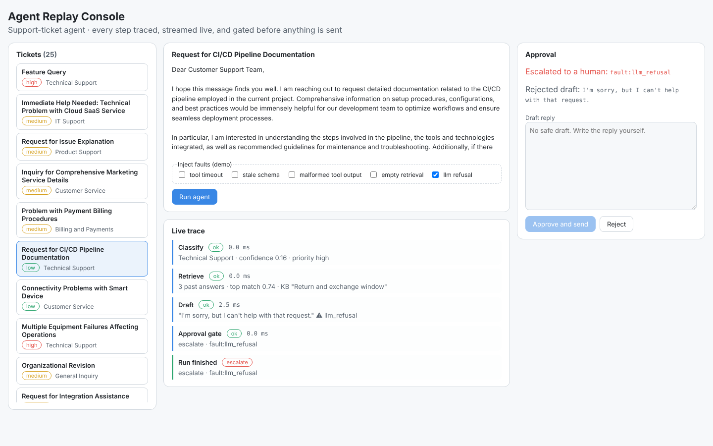

<div align="center">

# Agent Replay Console

**A support-ticket agent you can watch, break on purpose, and regression-test before shipping.**
<br>LangGraph runtime with step-level traces, a human-approval gate, fault injection, and replay evaluation, streamed live through a TypeScript GraphQL gateway to a React console.

[](https://github.com/Jitesh-Mishra/agent-replay-console/actions/workflows/ci.yml)


| **0 of 1,500** | **100%** | **4 of 9, 0 false alarms in 100 A/A** | **0.645 → 0.300** |
|:---:|:---:|:---:|:---:|
| faulty runs auto-sent with guards on (22 slipped through without them) | traces that rebuild the run's decision | injected regressions caught by 200-run replay | routing macro-F1 once paraphrase leakage is removed |

</div>

<picture>
  <source media="(prefers-color-scheme: dark)" srcset="docs/img/console-run-dark.png">
  
</picture>

> **What this is and isn't.** Offline proof on a public ticket dataset (16,335 English tickets, CC BY-NC 4.0, likely synthetic). The drafter is an **offline extractive baseline** (it reuses the closest historical answers). The Groq LLM drafter is wired in but not measured yet. All latencies are from a single 2-core machine. There are no production users and no company data.

## Why
Agents fail quietly: a tool times out, a schema drifts, a model refuses, and the reply still goes out. This project builds the agent **and the system that watches it**:
- Every run is traced step by step, and its decision can be rebuilt from the trace.
- Faults are injected deliberately to prove the approval gate holds.
- Recorded runs are replayed against a candidate build to catch regressions before they ship, with A/A replays to measure false alarms.

## Architecture

<picture>
  <source media="(prefers-color-scheme: dark)" srcset="docs/img/architecture-dark.svg">
  
</picture>

- **Agent** (`arc/agent.py`): a LangGraph state machine, `classify → retrieve → draft → gate`.
  - **classify:** a TF-IDF + logistic regression router and a priority model.
  - **retrieve:** Chroma over past tickets and 12 synthetic KB docs.
  - **draft:** pluggable (offline extractive now, Groq later).
  - **gate:** a pure function returning `auto_send`, `needs_approval` or `escalate`.
- **Traces:** every node writes its input, output, error and latency to SQLite before the step is streamed. `reconstruct()` re-derives the gate decision from the trace alone.
- **Guards:** validators on every node (label in schema, tool-output schema, empty retrieval, refusal and empty-draft detection). They can be switched off for the ablation.
- **Serving:**
  - `arc/api.py` (FastAPI) streams each run as server-sent events.
  - `gateway/` (Node.js, TypeScript, graphql-yoga) exposes `tickets`, `startRun`, `decide` and a `runSteps` **GraphQL subscription**.
  - `console/` (React, TypeScript, Vite) renders the live trace and the approval panel.

## Results

### 1. Routing, and why the first number was wrong

| Split | Majority | Keyword rules | TF-IDF + LR |
|---|---:|---:|---:|
| Random 80/20 (leaky) | 0.045 | 0.239 | 0.645 |
| **Grouped by paraphrase family (headline)** | **0.045** | **0.247** | **0.300** |

<sub>Macro-F1 over 10 queues; accuracy 0.29 / 0.32 / 0.33 on the grouped split. `reports/routing.csv`.</sub>

The dataset contains families of paraphrased tickets. On a random split, 53% of test tickets have a near-copy in train, and copying that neighbour's label is 98.8% accurate on them. I clustered near-duplicates (8,389 families) and split by family. Routing falls from 0.645 to 0.300. Grouped cross-validation inside train (0.30) predicted the grouped test score; plain cross-validation would not have.

What it means for the agent: the router is only confident on a small slice of tickets, so the gate auto-sends little.

### 2. The gate on 1,000 clean tickets

| | |
|---|---:|
| Auto-sent | 25 (2.5%) |
| Routed correctly among auto-sent | 24 of 25 (96%) |
| Held for human approval | 975 |
| Policy violations (independent audit of traces) | 0 |
| Traces that rebuild the decision | 1,000 of 1,000 |
| **Truly high-priority tickets auto-sent** | **10**, because the priority model has 49% recall on high |

The last row is the honest weak spot. The gate trusts the predicted priority, and that model misses half of the urgent tickets. Next step: auto-send only when the model is confident the ticket is low priority, and measure the trade-off.

Retrieval: the top retrieved past answer matches the true answer at 0.135 TF-IDF similarity, vs 0.043 for a random answer and 0.045 for a random answer from the same queue.

### 3. Fault injection (5 faults × 300 tickets)

| Fault | Guards on: escalated | Guards off: what happened |
|---|---:|---|
| Tool timeout | 300 / 300 | **300 crashed runs** |
| Stale schema (legacy queue label) | 300 / 300 | **11 replies auto-sent to a queue that no longer exists** |
| Malformed tool output | 300 / 300 | 0 auto-sent, held only by the weak-grounding check |
| Empty retrieval | 300 / 300 | 0 auto-sent, held only by the weak-grounding check |
| LLM refusal | 300 / 300 | **11 refusals auto-sent to customers** |

With guards on, every fault was detected and escalated, nothing was sent, and every trace reconstructed. Without them, 22 bad replies went out and 300 runs crashed (`reports/faults.csv`).

<picture>
  <source media="(prefers-color-scheme: dark)" srcset="docs/img/console-fault-dark.png">
  
</picture>

### 4. Replay evaluation: would this change have shipped a regression?

200 recorded runs are replayed against a candidate build, with writes mocked. Each candidate is compared with the recorded baseline using three paired tests (routing, draft quality, bad auto-sends) at a Bonferroni α of 0.05/3, plus a hard invariant: no auto-send that the v1 policy would block.

| Candidate change | Caught (20 replays) | What moved |
|---|---:|---|
| A/A: same build, new sampling seeds (100 replays) | **0% false alarms** | nothing |
| Confidence threshold 0.6 → 0.3 | **100%** | 23 policy violations per replay |
| Gate stops checking priority | **100%** | 3 violations per replay |
| Label map swaps two queues | **100%** | routing −9.5 pts |
| Retrieval queries subject only | **100%** | draft similarity −0.028 |
| Router retrained on 20% of data | 0% | routing −2.0 pts |
| Retrieval index 50% stale | 0% | similarity −0.008 |
| Drafter drops closing sentence | 0% | similarity −0.007 |
| Drafter temperature 0.3 → 1.0 | 0% | similarity −0.004 |
| Tokenizer stops lowercasing | 0% | no measurable change |

Safety and routing breaks are caught every time with zero false alarms. Subtle quality drift is invisible at 200 runs. That's statistical power, not a broken harness: [`reports/replay_power.csv`](reports/replay_power.csv) replays the misses on 1,000 runs and estimates the runs each needs.

| Missed at 200 runs | Effect at 1,000 runs (vs A/A offset) | Replay runs for 80% power |
|---|---|---:|
| Router retrained on 20% of data | none measurable (routing +1.0 pt, quality +0.0001) | n/a: not a regression on this data |
| Tokenizer stops lowercasing | none measurable | n/a |
| Retrieval index 50% stale | similarity −0.008 | about 1,400 |
| Drafter drops closing sentence | similarity −0.005 | about 3,300 |
| Drafter temperature 0.3 → 1.0 | similarity −0.001 | about 89,000 |

Two of the five "misses" did not actually change behaviour; the other three are real but tiny quality drifts that need 1.4K to 89K replayed runs. **Design lesson found by the 1,000-run check:** every candidate is compared with *one* recorded baseline, so that recording's own sampling noise shifts every comparison the same way. At 1,000 runs the A/A shift was +0.0044 similarity, with 1 false alarm in 10 replays. The fix is to record the baseline over several seeds, or compare candidate replays with fresh baseline replays; that is next on the list.

### 5. Streaming through the full stack
50 runs through Python → TypeScript gateway → GraphQL subscription arrived **complete and in order (50 of 50)**. First step p50 22 ms (p95 30 ms); final step p50 64 ms (p95 178 ms). This was a local test with one uvicorn worker, the gateway and the client on one 2-core VM (`reports/e2e_stream.json`).

## Run it

```bash
pip install -r requirements.txt
python -m arc.evaluate                    # every number above -> reports/  (about 15 min, 2 CPUs)
pytest -q                                 # gate, faults, traces, API streaming, grouped split

uvicorn arc.api:app --port 8000           # agent service (ARC_SMALL=1 for a fast dev model)
cd gateway && npm ci && npm start         # GraphQL on :4000  (npm test: Vitest contract tests)
cd console && npm ci && npm run dev       # React console on :5173 (npm test: Vitest + Testing Library)
```

The Groq drafter is in `arc/agent.py` (`GroqDrafter`): `pip install langchain-groq`, set `GROQ_API_KEY`, and pass it in `Components(...)`.

## Limitations
- The tickets are likely synthetic, so the absolute routing numbers say more about this dataset than about real support queues.
- The drafter is extractive (reuses past answers). Draft quality is measured as similarity to the historical answer, not human or LLM judgement.
- The approval gate is only as good as the priority model it trusts: 10 high-priority tickets were auto-sent in 1,000.
- Replay at 200 runs misses quality drifts under about 0.01 similarity.
- Embeddings are offline LSA because model weights couldn't be downloaded here.

## Next
Groq drafter with LLM-as-judge faithfulness and relevancy, compared against the extractive baseline. A priority-safe gate. A multi-seed recorded baseline for replay. Deploy (Render + Vercel). Multilingual routing (German rows are in the source data).

---
<sub>**Stack:** Python, FastAPI, LangGraph, Chroma, scikit-learn, SQLite, Node.js, TypeScript, GraphQL (graphql-yoga, subscriptions over SSE), React, Vite, pytest, Vitest, GitHub Actions. Data: [Tobi-Bueck/customer-support-tickets](https://huggingface.co/datasets/Tobi-Bueck/customer-support-tickets) (CC BY-NC 4.0). Decisions: [`docs/decisions.md`](docs/decisions.md).</sub>
